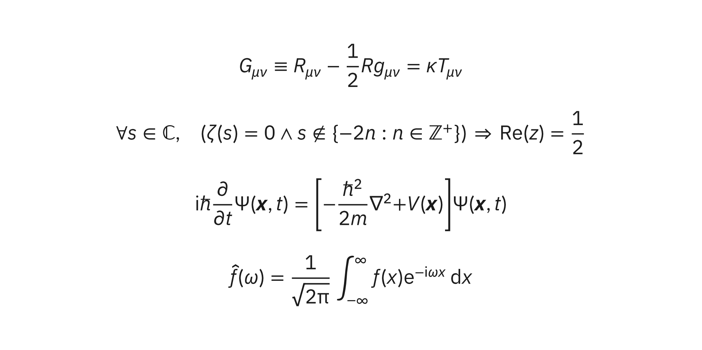
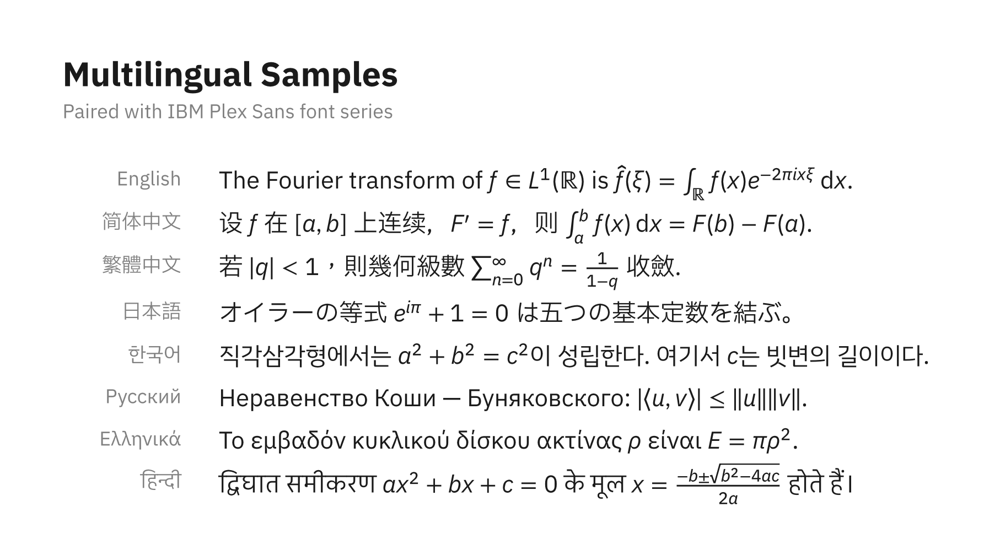
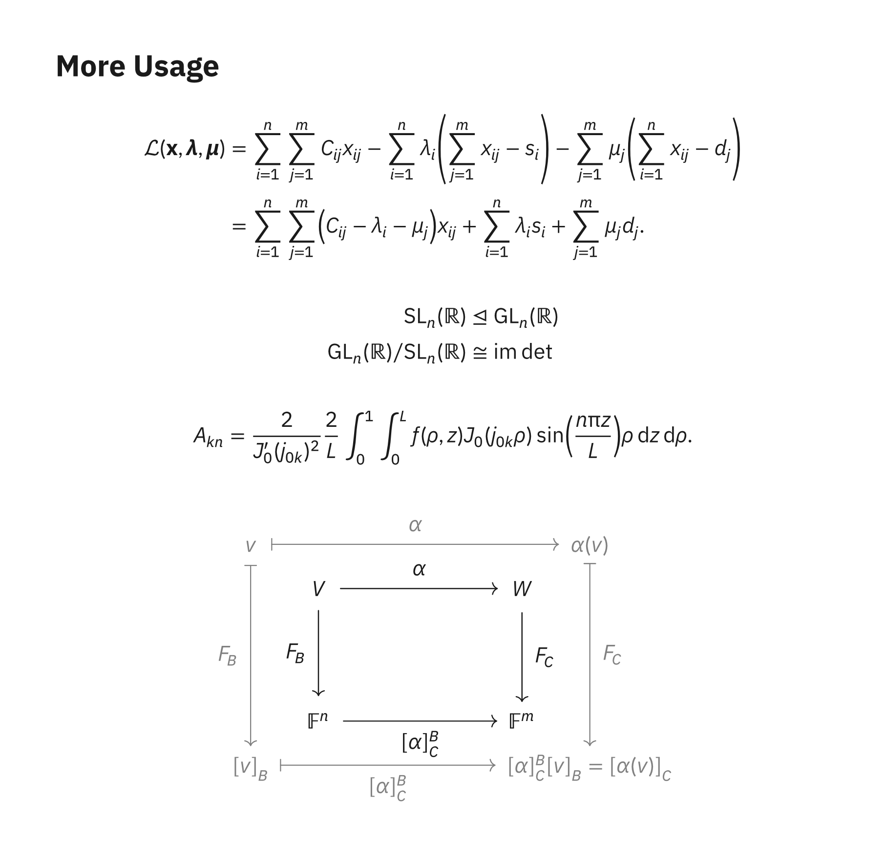

# Micfong Sans Math

An OpenType math font that goes well with IBM Plex. It derived from [Lete Sans Math](https://github.com/abccsss/LeteSansMath) with its alphanumeric glyphs substituted by glyphs from [IBM Plex Sans](https://github.com/IBM/plex) and IBM Plex Mono.

<picture>
  <source media="(prefers-color-scheme: dark)" srcset="docs/images/hero-dark.png">
  <source media="(prefers-color-scheme: light)" srcset="docs/images/hero-light.png">
  
</picture>

## Install

Download `MicfongSansMath.otf` and `MicfongSansMath-Bold.otf` from [Releases](https://github.com/micfong-z/micfong-sans-math/releases), or from [`dist/`](dist), and install the fonts.

## Use

**Typst**

```typst
#show math.equation: set text(font: "Micfong Sans Math")
```

**LaTeX** (XeLaTeX or LuaLaTeX)

```latex
\usepackage{unicode-math}
\setmathfont{MicfongSansMath.otf}[BoldFont = MicfongSansMath-Bold.otf]
```

## Samples

<picture>
    <source media="(prefers-color-scheme: dark)" srcset="docs/images/multilingual-dark.png">
    <source media="(prefers-color-scheme: light)" srcset="docs/images/multilingual-light.png">
    
</picture>

<picture>
    <source media="(prefers-color-scheme: dark)" srcset="docs/images/advanced-dark.png">
    <source media="(prefers-color-scheme: light)" srcset="docs/images/advanced-light.png">
    
</picture>

Sample documents: [Typst](samples/typst.typ) ([PDF](samples/typst.pdf)) and [LaTeX](samples/latex.tex) ([PDF](samples/latex.pdf)).

## How it's made

A Python script copies outlines from Plex into Lete Sans Math with `fontTools`, recalculates accent positions, italic corrections and kerning for the new letters, and checks the result. See [How it works](docs/how-it-works.md) (AI-generated document) for more details on replaced glyph ranges.

## Building from source

Needs `python3`, [`uv`](https://docs.astral.sh/uv/) and `typst`.

```sh
./build.sh                # newest releases of Lete Sans Math, IBM Plex Sans and Mono
./build.sh --lete v0.63   # pin Lete to a tag; --plex and --plex-mono pin the Plex packages
./scripts/render.sh       # README images, samples and the LaTeX proof
```

`build.sh` writes the fonts to `dist/` and a release archive to `build/`. If it hits GitHub's API rate limit, set `GITHUB_TOKEN`. `render.sh` also needs TeX Live and IBM Plex Sans SC, TC, JP, KR and Devanagari installed.

## Contributing

[Issues](https://github.com/micfong-z/micfong-sans-math/issues) and [Pull Requests](https://github.com/micfong-z/micfong-sans-math/pulls) are more than welcome.

## License

The fonts are licensed under the [SIL Open Font License 1.1](OFL.txt), and everything else (scripts, samples, TeX and Typst files) under the [MIT License](LICENSE-MIT).

Micfong Sans Math is a Modified Version of Lete Sans Math by Chenjing Bu and Daniel Flipo, which is based on Lato, and of IBM Plex Sans and IBM Plex Mono by IBM. Their copyright notices are kept in [OFL.txt](OFL.txt). "Lato" and "Plex" are Reserved Font Names of those fonts and are not used here. Micfong Sans Math has no Reserved Font Name.

See [Changelog](CHANGELOG.md) for release notes.
